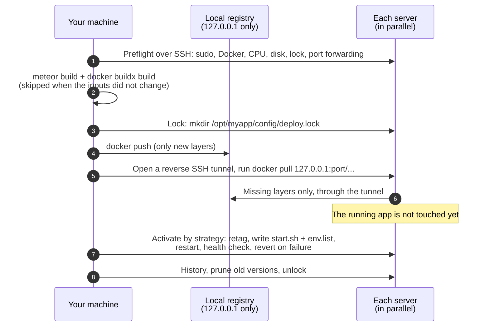
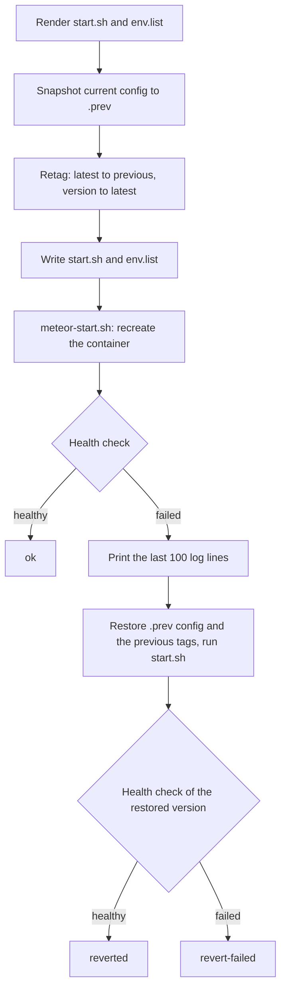

# How it works

[README](../README.md) · [Getting started](getting-started.md) · [Configuration](configuration.md) · [Commands](commands.md) · **How it works** · [Migrating from MUP](migrating-from-mup.md) · [Troubleshooting](troubleshooting.md)

This page describes what `comet-deploy deploy` does, step by step, and what it leaves on the servers.

- [Overview](#overview)
- [Why it is faster than MUP](#why-it-is-faster-than-mup)
- [1. Preflight](#1-preflight)
- [2. Build](#2-build)
- [3. Lock](#3-lock)
- [4. Distribute](#4-distribute)
- [5. Activate](#5-activate)
- [6. History, prune, unlock](#6-history-prune-unlock)
- [Rollout strategies](#rollout-strategies)
- [Locks](#locks)
- [Deploy history](#deploy-history)
- [Rollback](#rollback)
- [reconfig, restart, start, stop](#reconfig-restart-start-stop)
- [Behind the proxy](#behind-the-proxy)
- [What is on the servers](#what-is-on-the-servers)
- [Working side by side with MUP](#working-side-by-side-with-mup)
- [SSH connections](#ssh-connections)
- [Secrets](#secrets)

## Overview



The phases appear in the output as `==> Preflight`, `==> Build`, `==> Lock`, `==> Distribute` and `==> Activate`, each with its duration.

## Why it is faster than MUP

MUP 1.5.11 runs `meteor build` and packs a `bundle.tar.gz` locally. Then it walks the servers **one at a time**: upload the whole bundle, run `docker build` with a full `npm install` on the server (no layer cache, app stopped by default), upload `start.sh` and `env.list`, restart and check. The deploy time grows with every server.

comet-deploy:

- builds the image **once**, on your machine;
- keeps the `npm install` layer in the Docker build cache, so it only runs again when the dependencies change;
- skips the whole build when nothing changed;
- sends each server **only the layers it does not have**, to all servers **in parallel**;
- switches the app only when the image is already on the server, so the downtime per server is one container restart.

For a code-only change, only the layers with the changed app code travel, not the dependencies and not the whole bundle.

## 1. Preflight

Before anything is built, comet-deploy checks your machine and every target server in parallel and reports **all** problems at once (`Preflight failed:` followed by a list). Preflight runs for `deploy`, `meteor deploy`, `meteor push` and `meteor build`.

On your machine:

| Check | Error |
|---|---|
| `docker version` works | `Local Docker is not available: …` |
| buildx works and lists platforms (`docker buildx inspect`) | `Docker buildx is not available locally ("docker buildx inspect" failed). Install the buildx plugin; Docker Desktop and OrbStack include it.` |
| The buildx builder can build for every target platform | `The local Docker builder cannot build for linux/amd64. Enable emulation: …` |
| `<buildOptions.executable or meteor> --version` works | `The "meteor" command was not found locally. …` |

On every server:

| Check | Result |
|---|---|
| SSH connection | error `Server "<name>": Cannot connect …` |
| `sudo` installed and passwordless | error if sudo asks for a password or is missing |
| `bash` installed | error |
| Docker installed, running, version 18 or newer | error, with `Run "comet-deploy setup"` or `Run "comet-deploy docker update"` |
| Free space in Docker's root directory | warning below 5 GiB |
| CPU architecture (`uname -m`) | picks the target platform (`x86_64` → `linux/amd64`, `aarch64` → `linux/arm64`) unless `cometDeploy.platform` is set |
| App set up (`/opt/<name>/config` exists) | error `Server "<name>": the app is not set up on this server yet. Run "comet-deploy setup" first.` |
| Deploy lock | error if another deploy holds it (skipped with `--force-unlock` or `cometDeploy.lock: false`) |
| Reverse proxy (with a `proxy` section, on every proxy server) | error `Server "<name>": the reverse proxy is not set up (container mup-nginx-proxy is missing or stopped). Run "comet-deploy proxy setup" first.` |
| MongoDB (with a `mongo` section; `deploy` only) | error `Server "<name>": MongoDB (container "mongodb") is not running. Start it with: comet-deploy mongo start` (or `Set it up with: comet-deploy setup`). `reconfig`, `restart`, `rollback` and `start` make the same check before they touch the app. |
| SSH reverse port forwarding | error if `sshd` refuses it (`AllowTcpForwarding no`) |

`meteor build` sends nothing to the servers, so it skips the app setup, lock and port forwarding checks. `meteor build` and `meteor push` start no app, so both skip the proxy and MongoDB checks. It still connects to every server to read its CPU architecture.

Hooks run before and after the steps, under MUP's keys: `pre.default.deploy` before preflight, `pre.meteor.build` before the build, `pre.meteor.prepareBundle` after the lock and before the distribution, `pre.meteor.start` before the activation, `post.default.deploy` after the unlock. See [Configuration → Hooks](configuration.md#keys-and-nesting).

## 2. Build

### Version

Each deploy gets a version tag: `YYYYMMDD-HHMMSS-<sha7>` from the start time (UTC) and the app's git commit, with `-dirty` when the work tree has uncommitted changes. Outside git it is only `YYYYMMDD-HHMMSS`. The image is tagged `mup-<name>:<version>` locally and on the servers.

### Input hash and build cache

Before building, comet-deploy computes a hash of everything that can change the result:

- every file under `app.path`, by relative path and **content** (modification times do not matter), except `.meteor/local`, `node_modules`, `.git`, the build directory, and the config directory (the folder with `mup.js`) when it is a dot folder inside the app, such as `.deploy/`; symlinks are followed;
- `node_modules` as a list of `name@version` for every top-level and scoped package (a symlinked package, for example a workspace package, is hashed by content);
- `buildOptions`, the target platform, the comet-deploy version, `docker.image`, `docker.buildInstructions` and the Dockerfile format version;
- the values of the `env` keys that `docker.buildInstructions` use, because they become build args (only a digest of them is stored, not the values).

If the hash matches an earlier build for the same platform and that image is still in your local Docker, both `meteor build` and `docker build` are skipped:

```
No changes since 20261111-091502-3f2a1c9: reusing mup-myapp:20261111-091502-3f2a1c9
```

The deploy then activates that image again, under its original version. `--force-build` builds anyway; `--cached-build` reuses the newest local image even if the app changed.

The cache state lives outside your repository, in `~/.cache/comet-deploy/<hash of the app path>/state.json` (or under `$XDG_CACHE_HOME`). It keeps the last 20 builds of the app. When it forgets an older build, it removes that build's local image `mup-<name>:<version>` too (`docker rmi`, best effort: an image that is still in use stays).

The rule is "a needless build is better than a wrong skip". Any file under the app directory counts, except the paths listed above. The usual MUP layout, a `.deploy/` folder inside the app with `mup.js` and `settings.json`, is excluded, so editing those does not trigger a build: Meteor never bundles a folder whose name starts with a dot. A config folder without the dot (`deploy/`, `private/deploy/`) or a `mup.js` in the app root itself does count, because Meteor loads or bundles those files. `env` and settings are not part of the image (except the `env` keys your `buildInstructions` use), so a change that only touches them can use `reconfig` instead.

### meteor build

`meteor build --directory <buildLocation> --architecture <arch>` runs locally, with the same arguments MUP builds from `buildOptions` and with `METEOR_HEADLESS=1`. The architecture is `os.linux.x86_64` or `os.linux.aarch64`, from the target platform. No tarball is created. With the default `buildLocation`, the directory is cleaned before each build (MUP behaviour).

The Node version of the bundle is read from `bundle/star.json` (`nodeVersion`), or from `bundle/.node_version.txt`, and passed to the image build as `NODE_VERSION`, as MUP does.

### The layered Dockerfile

comet-deploy generates a Dockerfile that splits the bundle in two: the inputs of `npm install` first, the rest of the app after it. For a Meteor 3 bundle with `docker.image: 'zodern/meteor:root'` and one build instruction, it looks like this:

```dockerfile
# Generated by comet-deploy (Dockerfile v2)
FROM zodern/meteor:root
RUN mkdir /built_app || true
RUN apt-get update && apt-get install -y --no-install-recommends imagemagick
COPY --chown=app:app bundle/programs/server/npm-rebuild-args.js bundle/programs/server/npm-rebuild.js bundle/programs/server/npm-rebuilds.json bundle/programs/server/npm-shrinkwrap.json bundle/programs/server/package.json /built_app/programs/server/
COPY --chown=app:app bundle/programs/server/npm /built_app/programs/server/npm
RUN cd /built_app/programs/server && npm install --unsafe-perm
COPY --chown=app:app bundle/README /built_app/README
COPY --chown=app:app bundle/main.js /built_app/main.js
COPY --chown=app:app bundle/server /built_app/server
COPY --chown=app:app bundle/star.json /built_app/star.json
COPY --chown=app:app bundle/programs/web.browser /built_app/programs/web.browser
COPY --chown=app:app bundle/programs/web.browser.legacy /built_app/programs/web.browser.legacy
COPY --chown=app:app bundle/programs/server/app /built_app/programs/server/app
COPY --chown=app:app bundle/programs/server/assets /built_app/programs/server/assets
...
```

- **The deps layer.** The first two `COPY` lines take only what `npm install` reads in `programs/server`: `package.json`, `npm-shrinkwrap.json` / `package-lock.json`, `npm-rebuild.js`, `npm-rebuilds.json`, the scripts named in `package.json` and the local files they `require()`, and the `npm/` directory with the app's npm packages. BuildKit keys a `COPY` by the **content** of the files, so as long as these files are byte-identical, the `npm install` layer comes from the cache (the build log shows `CACHED`), even though `meteor build` wrote them fresh. A code-only change then rebuilds only the `COPY` layers after it.
- **Meteor's portable markers.** During a build Meteor writes `.meteor-portable*.json` files into `node_modules`. They are not needed at runtime but would change the deps layer after every fresh `npm install`. comet-deploy excludes them from the build context (a generated `.dockerignore`) and from its hash.
- **Native modules.** `npm install` runs `node npm-rebuild.js`, which rebuilds the native modules for the target platform inside the image, the same as on a MUP server.
- **Build instructions.** `docker.buildInstructions` go right after `FROM`. comet-deploy always applies them.
- **No secrets.** Env values are not baked in. Only env keys that a build instruction references as `$KEY` or `${KEY}` become `ARG`s, with a warning.
- **Ownership.** For `zodern/meteor*` images the files are copied with `--chown=app:app`, so `npm install` can run as the image's `app` user.

comet-deploy also computes its own content hash of the deps inputs and stores it as the image label `comet-deploy.deps-hash`, next to `comet-deploy.version`.

The image is built with:

```
docker buildx build --load --progress plain --platform linux/amd64 -t mup-myapp:<version> \
  --build-arg NODE_VERSION=<from star.json> --label comet-deploy.deps-hash=… --label comet-deploy.version=… -f - <buildLocation>
```

Before the build, comet-deploy runs `docker pull --platform <platform> <docker.image>` locally; a failed pull is ignored (as in MUP) and the build reports real problems.

### Several platforms

If the servers have different architectures (some `x86_64`, some `aarch64`), `meteor build` and the image build run once per platform. Locally the tags get an `-amd64` / `-arm64` suffix; each server receives the image for its platform under the same `mup-<name>:<version>` tag.

### Emulation

On an Apple Silicon Mac, an image for `linux/amd64` servers is built under emulation (Rosetta or QEMU, provided by Docker Desktop or OrbStack). Emulation slows down `npm install` and the native module build, so it costs time only when the deps layer is rebuilt, that is when the dependencies change. For `linux/arm64` servers the build is native. See [Troubleshooting](troubleshooting.md#building-on-an-arm64-mac-for-amd64-servers).

## 3. Lock

comet-deploy takes the deploy lock on every target server (see [Locks](#locks)). If one server is already locked, it releases the locks it took and stops, naming the holder. This happens after the build, so a long build does not block other people.

## 4. Distribute

1. **Local registry.** comet-deploy starts a Docker Distribution registry on your machine: container `comet-deploy-registry`, image `registry:2.8.3`, published on `127.0.0.1` with a random port (never on a public interface), data in the volume `comet-deploy-registry-data`. The volume persists between deploys, so layers that are already there are not pushed again.
2. **Push.** The new image is pushed to the registry as `127.0.0.1:<port>/mup-<name>:<version>`.
3. **Reverse tunnel, per server, in parallel.** comet-deploy opens an SSH reverse tunnel on the server: connections to `127.0.0.1:<server port>` on the server reach the local registry through the existing SSH connection. The server picks a free port.
4. **Pull on the server:**

   ```bash
   sudo docker pull 'zodern/meteor:root' || true        # base image from its own registry
   sudo docker pull '127.0.0.1:<port>/mup-myapp:<version>'  # missing layers only, through the tunnel
   sudo docker tag  '127.0.0.1:<port>/mup-myapp:<version>' 'mup-myapp:<version>'
   sudo docker rmi  '127.0.0.1:<port>/mup-myapp:<version>'
   ```

   The base image comes straight from its registry (Docker Hub for `zodern/meteor`), which is usually faster than your uplink. If that pull fails, the base layers come through the tunnel instead. Docker allows plain HTTP for registries on `127.0.0.0/8`, so nothing has to be configured on the server.

5. The tunnel closes, and the local registry stops at the end of the deploy (the container and the volume stay). One registry serves all deploys on your machine: each running deploy holds a lease on it, and the last one to finish stops it.

The running app is **not touched** during the distribution: `start.sh`, `env.list` and `:latest` still point to the old version, so `mup restart` or a server reboot in the meantime keeps running the old version. If the pull fails on any server, the deploy stops before activation with `Image distribution failed: …` and `No server was changed.`

`comet-deploy meteor push` ends here.

## 5. Activate

The servers are activated by the [rollout strategy](#rollout-strategies). On each server:

1. **Render** `start.sh` and `env.list` from the config. A config that cannot be rendered (for example an `env.list` line over 64 KiB) fails here, before anything changes on the server.
2. **Snapshot**: copy the current `start.sh` and `env.list` to `/opt/<name>/config/.prev/`.
3. **Retag**: `mup-<name>:latest` → `:previous` (when it is a different image), then `mup-<name>:<version>` → `:latest`. `:latest` changes last. If moving `:latest` fails, `:previous` is put back too, so both tags stay as they were.
4. **Write** the new `start.sh` and `env.list`. `env.list` gets mode `600` on every write, also when the file already existed with other permissions (for example `644` from an earlier MUP deploy).
5. **Start**: MUP's `meteor-start.sh`, which runs `sudo bash /opt/<name>/config/start.sh`: it removes the old container and runs the new one (`docker run -d --restart=always --name=<name> …`). This is the only downtime on the server; behind the proxy there is none (see [Behind the proxy](#behind-the-proxy)).
6. **Health check**, see below.



### Health check

The health check runs on the server. It polls `http://<container IP>:<port><path>` once a second with `curl` (25 s timeout per request), where:

- `<port>` is `app.deployCheckPort`, default `app.docker.imagePort` (3000);
- `<path>` is `cometDeploy.healthCheck.path` (default `/`);
- the container IP comes from `docker inspect`; for a container on the host network it is `localhost` (same detection as MUP).

| Outcome | Condition |
|---|---|
| healthy | an HTTP status ≤ `cometDeploy.healthCheck.maxStatus` (default 499) |
| `no healthy answer within <n>s` | `app.deployCheckWaitTime` (default 60 s) passed without such an answer |
| `the container stopped or is restarting` | the container is `exited`, `restarting`, `dead` or gone: fails at once instead of waiting for the timeout |
| `the container got no IP address` | no IP after 10 tries |

MUP's deploy check accepts any HTTP answer, including a 500. comet-deploy does not.

### Automatic revert

If the start or the health check fails, comet-deploy:

1. prints the last 100 lines of the container log (`Last log lines on "<server>":`);
2. restores `start.sh` and `env.list` from the snapshot and puts `:latest` and `:previous` back on exactly the images they named before;
3. runs `start.sh` again and **health-checks the restored version**.

The server's result is `reverted` when the old version answers again, and `revert-failed` (shown as `failed`) when it does not either. A server that failed before anything was changed is `failed` with `(the server was not changed)`.

## 6. History, prune, unlock

After the activation phase:

1. **History.** Every server that was activated gets one line in its deploy history, with its own result (`success`, `reverted` or `failed`). See [Deploy history](#deploy-history).
2. **Prune**, on the healthy servers:
   - version tags that never ran healthy on that server (according to its history) are removed;
   - of the rest, the newest `cometDeploy.keepVersions` (default 5) stay, older ones are removed;
   - the images behind `:latest` and `:previous` are never removed;
   - then `docker image prune -f` removes dangling images (old base images, images that lost their last tag), as MUP does on every deploy.
3. **Unlock** all servers, stop the local registry.
4. **Summary table** and, when some servers run the new version and others do not, a `MIXED VERSIONS` warning that tells you what to do.

Locks are released and the registry lease is given up (stopping the registry if no other deploy uses it) even when the deploy fails or is aborted.

## Rollout strategies

The servers are activated in the order of the keys in `app.servers` (after `--servers` filtering).

| Strategy | Order | When a server fails |
|---|---|---|
| `canary` (default) | The first server alone. If it is healthy, all others in parallel. | If the canary fails, it is reverted and the other servers are skipped: they keep the old version. If a server fails in the parallel phase, only that server is reverted; the others stay on the new version (mixed versions, reported). |
| `rolling` | One server after another. | The failed server is reverted; the remaining servers are skipped. The servers before it stay on the new version (reported). |
| `parallel` | All servers at once. | Each failed server is reverted on its own; healthy servers stay on the new version (reported). Fastest, but all servers restart at the same time. |

Set the default with `cometDeploy.strategy`, or per run with `--strategy`. The strategy also applies to `reconfig`, `restart` and `rollback`.

There is no automatic rollback of the servers that succeeded. When the result is mixed, the output says which servers run what and suggests either fixing the problem and deploying again, or `comet-deploy rollback --servers <healthy servers>`. See [Troubleshooting](troubleshooting.md#mixed-versions-after-a-partial-failure).

## Locks

`deploy`, `reconfig`, `restart`, `rollback` and `meteor push` lock every target server before they change anything:

- The lock is a directory, `/opt/<name>/config/deploy.lock/`, created with `mkdir`, which succeeds for exactly one process. Inside is `info.json` with the user (git `user.name` or the OS user), the machine, the PID, the start time, the command and the comet-deploy version.
- A second deploy fails in preflight (or at the lock step) with the name of the holder.
- The servers are locked one at a time, in the order of their names, and the lock step stops at the first server that is already locked. Of two deploys that start at the same moment and want the same servers, the one that locks the first of them gets all of them; the other one stops.
- Locks are released at the end, also on errors and on Ctrl+C.
- Locks do not expire. A lock left behind (killed process, second Ctrl+C, lost connection) is released with `comet-deploy unlock`, or with `--force-unlock` on the next command. Both print who held it.
- `cometDeploy.lock: false` turns locking off.
- With proxy load balancing, every app server is locked, also with `--servers`; the `proxy` commands lock the app servers too. See [Locks with the proxy](#locks-with-the-proxy).

MUP does not know these locks. Do not run `mup deploy` while a comet-deploy deploy is running.

## Deploy history

Each server keeps its own history in `/opt/<name>/config/deploy-history.jsonl`, one JSON object per line, appended by `deploy`, `reconfig`, `restart` and `rollback`:

```json
{"version":"20261111-091502-3f2a1c9","action":"deploy","result":"success","startedAt":"2026-11-11T09:15:02.118Z","durationMs":41200,"user":"Jane Doe","machine":"laptop","servers":["one","two"],"tool":"comet-deploy@0.2.0","git":{"commit":"3f2a1c9…","branch":"main","dirty":false}}
```

| Field | Meaning |
|---|---|
| `version` | The version tag (`null` for `reconfig` and `restart`, and for a rollback to `:previous`). |
| `action` | `deploy`, `reconfig`, `restart` or `rollback`. |
| `result` | `success`, `reverted` or `failed` on this server. |
| `startedAt`, `durationMs` | When the command started and how long it took. |
| `user`, `machine` | Git `user.name` (or the OS user) and the host name of the machine that deployed. |
| `servers` | All servers the command targeted. |
| `git` | Commit, branch and dirty flag of the app, when it is in git. |
| `tool` | `comet-deploy@<version>`. |

`comet-deploy history` reads the files from all app servers and merges them into one table. The history also drives `rollback` and pruning: they use it to know which versions ran healthy on which server.

## Rollback

`comet-deploy rollback` switches `:latest` back to an image that is still on the server and restarts the app, by strategy, with the health check. Nothing is built or transferred.

- Without `--to`, each server picks the newest kept version that is older than the one that runs and that ran healthy there. A server deployed by MUP (no version tags) swaps `:latest` and `:previous`.
- With `--to <version>`, every server goes to that version.
- Only the image changes; `start.sh` and `env.list` stay as they are.
- A failed rollback returns that server to the image that ran before.

Details and the exact rules: [Commands → rollback](commands.md#rollback).

## reconfig, restart, start, stop

| Command | Image | `start.sh` / `env.list` | Health check | On failure |
|---|---|---|---|---|
| `reconfig` | unchanged | rewritten from the config and settings | yes, by strategy | previous config restored and restarted |
| `restart` | unchanged | unchanged | yes, by strategy | reported (nothing to revert) |
| `start` | unchanged | unchanged | yes, all servers in parallel | reported |
| `stop` | unchanged | unchanged | - | reported |

`stop` removes the container (as MUP does); `start` creates it again from `start.sh`.

## Behind the proxy

With a `proxy` section the app runs behind MUP's reverse proxy: `zodern/nginx-proxy:v1.1.0` in the container `mup-nginx-proxy` and the Let's Encrypt companion `jrcs/letsencrypt-nginx-proxy-companion:v1.13.1` in `mup-nginx-proxy-letsencrypt`, one pair per server, shared by every app on that server. Inside `mup-nginx-proxy`, docker-gen writes the nginx config from the running containers (their `VIRTUAL_HOST`) and from the files in `/opt/mup-nginx-proxy`. comet-deploy uses MUP 1.5.11's scripts, templates and images unchanged.

### Setup and the proxy containers

`setup` and `proxy setup` run MUP's proxy scripts and upload the same files as MUP. MUP then always recreates the proxy containers, which interrupts every app on the server. comet-deploy recreates them only when one of the files they are created from changed (`config/start.sh`, `shared-config.sh`, `env.list`, `env_letsencrypt.list`, `nginx-default.conf`, `nginx.tmpl`, `nginx-shared.tmpl`) or when they do not both run. It compares a checksum of these files from before and after the upload; nothing extra is stored on the server. When nothing changed, it prints `[<server>] proxy up to date` and regenerates the nginx config once (docker-gen inside `mup-nginx-proxy`, then `nginx -t` and a reload), so new or removed files of the app still take effect. `proxy start` always recreates the containers, as in MUP.

With load balancing, `setup` and `proxy setup` write the app's upstream only when its servers and ports already match the config (MUP's file, with the `down` marks kept). MUP writes the config's upstream at once, and when the running containers do not publish that port yet, every request fails until the next deploy. comet-deploy leaves turning load balancing on, and moving a server to a new `PORT` or address, to the next `deploy`, which does it server by server once each one runs the config (see below). The config container `mup-proxy-configure-<app>` follows the upstream.

### The app's proxy files on deploy

MUP writes the app's proxy files only in `setup`: a `mup deploy` after a change of `clientUploadLimit` or of a certificate leaves the old files in place. comet-deploy brings them up to date on every `deploy` and `reconfig`, on every proxy server:

- `vhost.d/<domain>` (`clientUploadLimit`, `nginxServerConfig`) and `vhost.d/<domain>_location` (`nginxLocationConfig`),
- your own certificates (`ssl.crt`, `ssl.key`) in `certs/` and `mounted-certs/`,
- with load balancing, `upstream/<app>`, the links `vhost.d/<domain>_upstream`, and the config container `mup-proxy-configure-<app>`.

The content is what `mup proxy setup` writes with the same config; the integration tests compare the files byte for byte. Only files that differ are written, and the output names them. A changed file needs only `nginx -s reload`. A new or removed file needs the nginx config regenerated, because docker-gen decides which files exist when it generates; comet-deploy regenerates it without restarting the proxy containers.

The order keeps nginx from pointing at something that does not run:

- Domain files and certificates are written before activation.
- Turning `loadBalancing` on writes the upstream after every server has been activated; until then nginx routes to the containers as it does without load balancing. If a server did not deploy, load balancing is not turned on yet: `loadBalancing was not enabled on the proxies because <servers> did not deploy; run the deploy again`.
- Turning `loadBalancing` off removes the upstream before activation.
- A changed `app.env.PORT`, `privateIp` or `host` changes that server's line in the upstream when the server is activated and healthy with the new config. A server that is reverted, skipped or not selected with `--servers` keeps its line, because it still runs its previous `start.sh`. A new server joins the upstream after it is healthy; a removed server leaves it at the start. A server that has no line at the end (a new server or a new address that did not deploy) is named: `"<server>" is not in load balancing: it does not run this config yet. Run "comet-deploy deploy --servers <server>" to add it.`

`rollback` and `restart` do not change the proxy files: they run the server's own `start.sh`, so the upstream keeps every server's address and port, and only the `down` marks change.

**Shared settings.** `proxy.shared` configures the proxy itself, so applying it restarts the proxy for every app on the server. `deploy` never applies it. When the app's config has a `shared` section whose effect differs from the files on a proxy server, `deploy` warns: `The shared proxy settings (proxy.shared) differ from the ones on <servers>. A deploy does not apply them, because that restarts the proxy for every app on the server. Run "comet-deploy proxy reconfig-shared" to apply them.` A config without `shared` never warns, so it never leads you to overwrite the settings another app has set.

### Switching without a gap

Without load balancing, the app publishes no port on the host (MUP uses `--expose`), so a second container can run beside it. `deploy`, `reconfig`, `restart` and `rollback` switch like this:

1. Start `<app>-next` from the server's `config/start.sh`: the same container, under another name, without the step that removes the running one.
2. Run the health check on `<app>-next`.
3. Wait until nginx routes to it (docker-gen adds it to the config; up to 15 s).
4. Make nginx route only to `<app>-next`: a file `vhost.d/<domain>_upstream` with its address, which MUP's nginx template uses instead of the containers (the mechanism of MUP's load balancing). Without it, any regeneration of the nginx config, for example by the Let's Encrypt companion, would list the old container again, and a request nginx sends to it after it stopped would hang until a timeout: the stopped container's address no longer exists.
5. Stop the old container (`docker stop`, 10 s for the requests in flight), remove it, and rename `<app>-next` to `<app>`.
6. Remove the `_upstream` files again and regenerate the nginx config, which then lists the renamed container as before. The files are removed also when the step fails or the SSH connection drops; a file left by a killed process is recognized by its first line (`# comet-deploy zero-downtime switch`) and replaced by the next switch.

The result looks exactly like a container that `start.sh` created. If the health check fails, `<app>-next` is removed, the tags and the config go back as in a normal [revert](#automatic-revert), and the old container, which never stopped, keeps serving: the server ends `reverted` without a gap.

**Known compromise.** docker-gen adds `<app>-next` to nginx as soon as it starts, before its health check. Until the new Meteor listens, nginx passes those requests on to the old container. Once it listens, part of the requests reach the new version during its health check, so if it answers with errors, some users see them for a short time.

The switch is not used when it cannot be safe, and the output says why in one line (`Zero-downtime switch not used: <reason>`): `cometDeploy.zeroDowntime: false`, active load balancing (see below), `docker.args` that publishes a host port (`-p`, `-P`, `--publish`), uses the host network or sets `--name`, or `docker.networks` with `host`. The server then restarts in place, as with MUP.

### Load balancing: taking a server out of the upstream

With `loadBalancing`, every app container publishes `app.env.PORT` on its server, so two containers cannot run side by side. MUP restarts the app while the server is still in the upstream, and the requests in flight on it fail. comet-deploy takes the server out first, on every proxy server:

1. Rewrite `upstream/<app>` with the server marked `down` (an nginx directive that keeps the `ip_hash` distribution of the other servers) and reload nginx (`[<server>] drain ✓ out of load balancing`).
2. Wait 5 s for the requests in flight.
3. Restart the app on that server and run the health check.
4. Once it is healthy, write `upstream/<app>` back to exactly what MUP's `upstream.sh` writes, and reload nginx.

Rules:

- **Never all servers at once.** A step that would leave no server up runs without draining: the `parallel` strategy, and an app on a single server. With `canary`, the other servers are drained only after the canary server is healthy, so it stays up.
- **The `down` mark is the only record.** Nothing else is stored on the server. comet-deploy removes a server's mark only after that server passed a health check in `deploy`, `reconfig`, `rollback` or `restart`. Every other rewrite of the upstream keeps the marks: `setup`, `proxy setup`, and a deploy with `--servers` that does not restart that server.
- **Failures.** A server that ends `reverted` goes back in after its restored version passed the check. A server that ends `revert-failed`, or that an interrupted deploy left drained (a lost connection, a killed process), stays out, and the command says so: `"<server>" stays out of load balancing because it did not end healthy. Once it is healthy, run "comet-deploy restart --servers <server>" to put it back.` `status` and `proxy status` list it as `Drained:`. See [Troubleshooting](troubleshooting.md#a-server-stays-out-of-load-balancing).
- **Ctrl+C.** The servers that passed their health check go back in before the command exits, as the locks are released.
- **`--servers`** updates every proxy whose upstream holds a restarted server, also when that proxy server is not in `--servers`.
- **A proxy server that cannot be written** is tried again with every later write, at the latest at the end of the command. If it is still unreachable then, the command names it and the servers that may still be out of load balancing there: `Could not update the reverse proxy on "<proxy>": …. Its upstream may still have <servers> out of load balancing: once "<proxy>" is reachable, run "comet-deploy restart --servers <servers>".` A server counts as out of load balancing when it is marked `down` on any proxy server.
- **MUP.** `mup proxy setup` rewrites the upstream without the marks, so it puts drained servers back in. comet-deploy cannot prevent that.
- `cometDeploy.zeroDowntime: false` turns draining off; the restart is then the same as with MUP.

### Locks with the proxy

- With load balancing, `deploy`, `reconfig`, `rollback` and `restart` lock **every** app server, also with `--servers`: all servers share one upstream, and two deploys of different servers at the same time could drain both.
- `setup`, `proxy setup`, `proxy start`, `proxy stop` and `proxy reconfig-shared` take the app's lock on its servers, so they never rewrite the upstream in the middle of a deploy. For a proxy server where the app does not run, the app servers are locked.
- Other apps on the same proxy are not locked out. If another app's `proxy start` or `reconfig-shared` recreates the proxy while this app switches, the new proxy generates its config from the running containers, so the switch still works. Requests during the proxy restart itself fail, as they do with MUP.

### Docker versions

MUP's proxy images are several years old. They were checked with Docker 27.5.1 and Docker 29.9.3 on the servers: nginx-proxy generates the config for the app's container and routes to it, and the Let's Encrypt companion sees the containers. The integration tests run `setup`, a certificate from a local ACME test server and a zero-downtime deploy under load on both versions. Docker 29 no longer fills the deprecated `.NetworkSettings.IPAddress` field, so comet-deploy reads container IPs from `.NetworkSettings.Networks`.

## What is on the servers

comet-deploy keeps the server layout of MUP 1.5.11 and adds a few files that MUP ignores.

| Item | Same as MUP | Notes |
|---|---|---|
| `/opt/<name>/config/start.sh` | yes | Rendered from MUP 1.5.11's template with the same template engine (`@zodern/ejs` 2.7.5) and the same variables, so the file is the same as MUP writes. One difference: per-server values (`bind`, `env.PORT`) never leak into the file of another server, which can happen in MUP because it reuses one variables object for all hosts. |
| `/opt/<name>/config/env.list` | yes | Same format. Mode `600`, set on every write. |
| `/opt/<name>/tmp/` | yes | Created by `setup`; comet-deploy does not upload a bundle there. |
| Container `<name>` | yes | `--restart=always`, `--env-file`, published port, log options, `docker.args`, as in MUP. |
| Image `mup-<lower-case name>:latest` and `:previous` | yes | `:latest` runs; `:previous` is the one before. |
| Image tags `mup-<lower-case name>:<version>` | added | One per kept version, for `rollback`. |
| `/opt/<name>/config/deploy-history.jsonl` | added | Deploy history. |
| `/opt/<name>/config/deploy.lock/` | added | Only while a command runs. |
| `/opt/<name>/config/.prev/` | added | Snapshot of the previous `start.sh` and `env.list`, for the automatic revert. |
| `/opt/mup-nginx-proxy/` and the containers `mup-nginx-proxy`, `mup-nginx-proxy-letsencrypt` | yes | Written by MUP's proxy scripts, with the same content. |
| `/opt/mongodb/` (`mongodb.conf`, `mongo-start-new.sh`, `mongo-start-current.sh`), the container `mongodb` and `mongo.dataPath` | yes | Written by MUP's mongo scripts; the start script is byte for byte MUP's, so `mup mongo start` keeps a container that comet-deploy started, and the other way round. |
| `down` marks in `/opt/mup-nginx-proxy/upstream/<name>` | added | Only for a server that is out of load balancing. nginx and MUP read the file as usual. |
| Container `<name>-next` | added | Only during a zero-downtime switch; renamed to `<name>` at its end. |

On your machine: the local images `mup-<name>:<version>` of the last 20 builds (older ones are removed), the build directory (`buildLocation`), the cache state and registry leases in `~/.cache/comet-deploy/`, and the stopped `comet-deploy-registry` container with its volume `comet-deploy-registry-data`, which is never cleaned up.

## Working side by side with MUP

Because the server layout is the same, both tools can manage the same app on the same servers. The integration tests check this with MUP 1.5.11 on one server:

1. `mup setup` and `mup deploy`.
2. `comet-deploy history` works (no history yet, no error).
3. `comet-deploy deploy` without `comet-deploy setup`; MUP's image becomes `:previous`. `mup restart` and `mup logs` keep working.
4. `comet-deploy rollback` returns to the version MUP deployed (`:previous`).
5. `mup deploy` still works afterwards.

With the proxy and load balancing, the tests also take turns between `mup setup`, `mup deploy`, `mup proxy setup` and `comet-deploy deploy`, and compare the app's proxy files (`vhost.d`, `upstream`, the config container's script) after each one: comet-deploy leaves them exactly as MUP wrote them.

Things to know:

- MUP ignores the version tags, the history, the lock and the snapshot. `mup deploy` moves `:latest` to `:previous` as usual, and comet-deploy's version tags stay.
- After a `mup deploy`, `comet-deploy status` shows `-` as the version (`:latest` is not a comet-deploy version), and `comet-deploy rollback` picks the newest kept comet-deploy version.
- MUP does not respect comet-deploy's lock. Do not run both at the same time.
- `mup proxy setup` clears the `down` marks of servers that are out of load balancing.
- MUP prints `cometDeploy is an unknown property` as a validation message and continues.
- `mup meteor destroy` removes `/opt/<name>/` (including the history) but leaves comet-deploy's version tags; `comet-deploy meteor destroy --force` removes them too.

More in [Migrating from MUP](migrating-from-mup.md).

## SSH connections

comet-deploy opens one SSH connection per server ([ssh2](https://github.com/mscdex/ssh2)) and uses it for every step: commands, file uploads (SFTP) and the reverse tunnel. Remote scripts are sent on stdin to `bash -s`, so no temporary script files are left on the server. Keepalives run every 28 s; a connection that dropped is opened again for the next step.

Authentication is `pem`, then `password`, then the ssh agent. Host keys are not verified, the same as MUP.

## Secrets

- Env values and settings are written only to `env.list` on the servers (mode `600`), never into the image or the local registry. The exception is an env key that `docker.buildInstructions` references, which becomes a build argument (with a warning).
- Output masks env values, SSH passwords, the SSH key passphrase, the settings JSON and its non-public string values (also those of per-server settings files) as `***`. This covers phase lines, `--verbose` output and error messages.
- The local registry listens on `127.0.0.1` only. The tunnel listens on `127.0.0.1` on the server and exists only during the distribution.
- `validate --show` prints the config as it is; use `--scrub` to share it.
