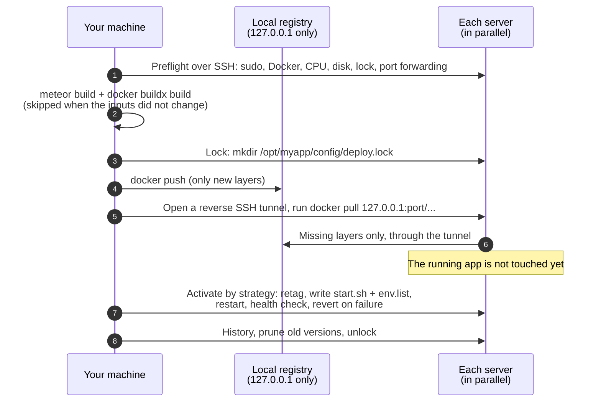
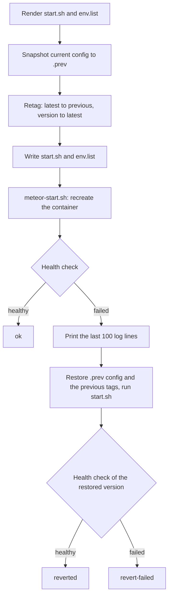

# How it works

[README](../README.md) · [Getting started](getting-started.md) · [Configuration](configuration.md) · [Commands](commands.md) · **How it works** · [Migrating from MUP](migrating-from-mup.md) · [Troubleshooting](troubleshooting.md)

This page describes what `comet-deploy deploy` does, step by step, and what it leaves on the servers.

- [Overview](#overview)
- [Why it is faster than MUP](#why-it-is-faster-than-mup)
- [1. Preflight](#1-preflight)
- [2. Build](#2-build)
- [3. Lock](#3-lock)
- [4. Distribute](#4-distribute)
- [5. Activate](#5-activate)
- [6. History, prune, unlock](#6-history-prune-unlock)
- [Rollout strategies](#rollout-strategies)
- [Locks](#locks)
- [Deploy history](#deploy-history)
- [Rollback](#rollback)
- [reconfig, restart, start, stop](#reconfig-restart-start-stop)
- [What is on the servers](#what-is-on-the-servers)
- [Working side by side with MUP](#working-side-by-side-with-mup)
- [SSH connections](#ssh-connections)
- [Secrets](#secrets)

## Overview



The phases appear in the output as `==> Preflight`, `==> Build`, `==> Lock`, `==> Distribute` and `==> Activate`, each with its duration.

## Why it is faster than MUP

MUP 1.5.11 runs `meteor build` and packs a `bundle.tar.gz` locally. Then it walks the servers **one at a time**: upload the whole bundle, run `docker build` with a full `npm install` on the server (no layer cache, app stopped by default), upload `start.sh` and `env.list`, restart and check. The deploy time grows with every server.

comet-deploy:

- builds the image **once**, on your machine;
- keeps the `npm install` layer in the Docker build cache, so it only runs again when the dependencies change;
- skips the whole build when nothing changed;
- sends each server **only the layers it does not have**, to all servers **in parallel**;
- switches the app only when the image is already on the server, so the downtime per server is one container restart.

For a code-only change, only the layers with the changed app code travel, not the dependencies and not the whole bundle.

## 1. Preflight

Before anything is built, comet-deploy checks your machine and every target server in parallel and reports **all** problems at once (`Preflight failed:` followed by a list). Preflight runs for `deploy`, `meteor deploy`, `meteor push` and `meteor build`.

On your machine:

| Check | Error |
|---|---|
| `docker version` works | `Local Docker is not available: …` |
| buildx works and lists platforms (`docker buildx inspect`) | `Docker buildx is not available locally ("docker buildx inspect" failed). Install the buildx plugin; Docker Desktop and OrbStack include it.` |
| The buildx builder can build for every target platform | `The local Docker builder cannot build for linux/amd64. Enable emulation: …` |
| `<buildOptions.executable or meteor> --version` works | `The "meteor" command was not found locally. …` |

On every server:

| Check | Result |
|---|---|
| SSH connection | error `Server "<name>": Cannot connect …` |
| `sudo` installed and passwordless | error if sudo asks for a password or is missing |
| `bash` installed | error |
| Docker installed, running, version 18 or newer | error, with `Run "comet-deploy setup"` or `Run "comet-deploy docker update"` |
| Free space in Docker's root directory | warning below 5 GiB |
| CPU architecture (`uname -m`) | picks the target platform (`x86_64` → `linux/amd64`, `aarch64` → `linux/arm64`) unless `cometDeploy.platform` is set |
| App set up (`/opt/<name>/config` exists) | error `Server "<name>": the app is not set up on this server yet. Run "comet-deploy setup" first.` |
| Deploy lock | error if another deploy holds it (skipped with `--force-unlock` or `cometDeploy.lock: false`) |
| SSH reverse port forwarding | error if `sshd` refuses it (`AllowTcpForwarding no`) |

`meteor build` sends nothing to the servers, so it skips the last three checks. It still connects to every server to read its CPU architecture.

Hooks in the config are checked even before preflight: a command refuses a hook on any step it will run before it starts. See [Configuration → Hooks](configuration.md#hooks).

## 2. Build

### Version

Each deploy gets a version tag: `YYYYMMDD-HHMMSS-<sha7>` from the start time (UTC) and the app's git commit, with `-dirty` when the work tree has uncommitted changes. Outside git it is only `YYYYMMDD-HHMMSS`. The image is tagged `mup-<name>:<version>` locally and on the servers.

### Input hash and build cache

Before building, comet-deploy computes a hash of everything that can change the result:

- every file under `app.path`, by relative path and **content** (modification times do not matter), except `.meteor/local`, `node_modules`, `.git`, the build directory, and the config directory (the folder with `mup.js`) when it is a dot folder inside the app, such as `.deploy/`; symlinks are followed;
- `node_modules` as a list of `name@version` for every top-level and scoped package (a symlinked package, for example a workspace package, is hashed by content);
- `buildOptions`, the target platform, the comet-deploy version, `docker.image`, `docker.buildInstructions` and the Dockerfile format version;
- the values of the `env` keys that `docker.buildInstructions` use, because they become build args (only a digest of them is stored, not the values).

If the hash matches an earlier build for the same platform and that image is still in your local Docker, both `meteor build` and `docker build` are skipped:

```
No changes since 20261111-091502-3f2a1c9: reusing mup-myapp:20261111-091502-3f2a1c9
```

The deploy then activates that image again, under its original version. `--force-build` builds anyway; `--cached-build` reuses the newest local image even if the app changed.

The cache state lives outside your repository, in `~/.cache/comet-deploy/<hash of the app path>/state.json` (or under `$XDG_CACHE_HOME`). It keeps the last 20 builds of the app. When it forgets an older build, it removes that build's local image `mup-<name>:<version>` too (`docker rmi`, best effort: an image that is still in use stays).

The rule is "a needless build is better than a wrong skip". Any file under the app directory counts, except the paths listed above. The usual MUP layout, a `.deploy/` folder inside the app with `mup.js` and `settings.json`, is excluded, so editing those does not trigger a build: Meteor never bundles a folder whose name starts with a dot. A config folder without the dot (`deploy/`, `private/deploy/`) or a `mup.js` in the app root itself does count, because Meteor loads or bundles those files. `env` and settings are not part of the image (except the `env` keys your `buildInstructions` use), so a change that only touches them can use `reconfig` instead.

### meteor build

`meteor build --directory <buildLocation> --architecture <arch>` runs locally, with the same arguments MUP builds from `buildOptions` and with `METEOR_HEADLESS=1`. The architecture is `os.linux.x86_64` or `os.linux.aarch64`, from the target platform. No tarball is created. With the default `buildLocation`, the directory is cleaned before each build (MUP behaviour).

The Node version of the bundle is read from `bundle/star.json` (`nodeVersion`), or from `bundle/.node_version.txt`, and passed to the image build as `NODE_VERSION`, as MUP does.

### The layered Dockerfile

comet-deploy generates a Dockerfile that splits the bundle in two: the inputs of `npm install` first, the rest of the app after it. For a Meteor 3 bundle with `docker.image: 'zodern/meteor:root'` and one build instruction, it looks like this:

```dockerfile
# Generated by comet-deploy (Dockerfile v2)
FROM zodern/meteor:root
RUN mkdir /built_app || true
RUN apt-get update && apt-get install -y --no-install-recommends imagemagick
COPY --chown=app:app bundle/programs/server/npm-rebuild-args.js bundle/programs/server/npm-rebuild.js bundle/programs/server/npm-rebuilds.json bundle/programs/server/npm-shrinkwrap.json bundle/programs/server/package.json /built_app/programs/server/
COPY --chown=app:app bundle/programs/server/npm /built_app/programs/server/npm
RUN cd /built_app/programs/server && npm install --unsafe-perm
COPY --chown=app:app bundle/README /built_app/README
COPY --chown=app:app bundle/main.js /built_app/main.js
COPY --chown=app:app bundle/server /built_app/server
COPY --chown=app:app bundle/star.json /built_app/star.json
COPY --chown=app:app bundle/programs/web.browser /built_app/programs/web.browser
COPY --chown=app:app bundle/programs/web.browser.legacy /built_app/programs/web.browser.legacy
COPY --chown=app:app bundle/programs/server/app /built_app/programs/server/app
COPY --chown=app:app bundle/programs/server/assets /built_app/programs/server/assets
...
```

- **The deps layer.** The first two `COPY` lines take only what `npm install` reads in `programs/server`: `package.json`, `npm-shrinkwrap.json` / `package-lock.json`, `npm-rebuild.js`, `npm-rebuilds.json`, the scripts named in `package.json` and the local files they `require()`, and the `npm/` directory with the app's npm packages. BuildKit keys a `COPY` by the **content** of the files, so as long as these files are byte-identical, the `npm install` layer comes from the cache (the build log shows `CACHED`), even though `meteor build` wrote them fresh. A code-only change then rebuilds only the `COPY` layers after it.
- **Meteor's portable markers.** During a build Meteor writes `.meteor-portable*.json` files into `node_modules`. They are not needed at runtime but would change the deps layer after every fresh `npm install`. comet-deploy excludes them from the build context (a generated `.dockerignore`) and from its hash.
- **Native modules.** `npm install` runs `node npm-rebuild.js`, which rebuilds the native modules for the target platform inside the image, the same as on a MUP server.
- **Build instructions.** `docker.buildInstructions` go right after `FROM`. comet-deploy always applies them.
- **No secrets.** Env values are not baked in. Only env keys that a build instruction references as `$KEY` or `${KEY}` become `ARG`s, with a warning.
- **Ownership.** For `zodern/meteor*` images the files are copied with `--chown=app:app`, so `npm install` can run as the image's `app` user.

comet-deploy also computes its own content hash of the deps inputs and stores it as the image label `comet-deploy.deps-hash`, next to `comet-deploy.version`.

The image is built with:

```
docker buildx build --load --progress plain --platform linux/amd64 -t mup-myapp:<version> \
  --build-arg NODE_VERSION=<from star.json> --label comet-deploy.deps-hash=… --label comet-deploy.version=… -f - <buildLocation>
```

Before the build, comet-deploy runs `docker pull --platform <platform> <docker.image>` locally; a failed pull is ignored (as in MUP) and the build reports real problems.

### Several platforms

If the servers have different architectures (some `x86_64`, some `aarch64`), `meteor build` and the image build run once per platform. Locally the tags get an `-amd64` / `-arm64` suffix; each server receives the image for its platform under the same `mup-<name>:<version>` tag.

### Emulation

On an Apple Silicon Mac, an image for `linux/amd64` servers is built under emulation (Rosetta or QEMU, provided by Docker Desktop or OrbStack). Emulation slows down `npm install` and the native module build, so it costs time only when the deps layer is rebuilt, that is when the dependencies change. For `linux/arm64` servers the build is native. See [Troubleshooting](troubleshooting.md#building-on-an-arm64-mac-for-amd64-servers).

## 3. Lock

comet-deploy takes the deploy lock on every target server (see [Locks](#locks)). If one server is already locked, it releases the locks it took and stops, naming the holder. This happens after the build, so a long build does not block other people.

## 4. Distribute

1. **Local registry.** comet-deploy starts a Docker Distribution registry on your machine: container `comet-deploy-registry`, image `registry:2.8.3`, published on `127.0.0.1` with a random port (never on a public interface), data in the volume `comet-deploy-registry-data`. The volume persists between deploys, so layers that are already there are not pushed again.
2. **Push.** The new image is pushed to the registry as `127.0.0.1:<port>/mup-<name>:<version>`.
3. **Reverse tunnel, per server, in parallel.** comet-deploy opens an SSH reverse tunnel on the server: connections to `127.0.0.1:<server port>` on the server reach the local registry through the existing SSH connection. The server picks a free port.
4. **Pull on the server:**

   ```bash
   sudo docker pull 'zodern/meteor:root' || true        # base image from its own registry
   sudo docker pull '127.0.0.1:<port>/mup-myapp:<version>'  # missing layers only, through the tunnel
   sudo docker tag  '127.0.0.1:<port>/mup-myapp:<version>' 'mup-myapp:<version>'
   sudo docker rmi  '127.0.0.1:<port>/mup-myapp:<version>'
   ```

   The base image comes straight from its registry (Docker Hub for `zodern/meteor`), which is usually faster than your uplink. If that pull fails, the base layers come through the tunnel instead. Docker allows plain HTTP for registries on `127.0.0.0/8`, so nothing has to be configured on the server.

5. The tunnel closes, and the local registry stops at the end of the deploy (the container and the volume stay). One registry serves all deploys on your machine: each running deploy holds a lease on it, and the last one to finish stops it.

The running app is **not touched** during the distribution: `start.sh`, `env.list` and `:latest` still point to the old version, so `mup restart` or a server reboot in the meantime keeps running the old version. If the pull fails on any server, the deploy stops before activation with `Image distribution failed: …` and `No server was changed.`

`comet-deploy meteor push` ends here.

## 5. Activate

The servers are activated by the [rollout strategy](#rollout-strategies). On each server:

1. **Render** `start.sh` and `env.list` from the config. A config that cannot be rendered (for example an `env.list` line over 64 KiB) fails here, before anything changes on the server.
2. **Snapshot**: copy the current `start.sh` and `env.list` to `/opt/<name>/config/.prev/`.
3. **Retag**: `mup-<name>:latest` → `:previous` (when it is a different image), then `mup-<name>:<version>` → `:latest`. `:latest` changes last. If moving `:latest` fails, `:previous` is put back too, so both tags stay as they were.
4. **Write** the new `start.sh` and `env.list`. `env.list` gets mode `600` on every write, also when the file already existed with other permissions (for example `644` from an earlier MUP deploy).
5. **Start**: MUP's `meteor-start.sh`, which runs `sudo bash /opt/<name>/config/start.sh`: it removes the old container and runs the new one (`docker run -d --restart=always --name=<name> …`). This is the only downtime on the server.
6. **Health check**, see below.



### Health check

The health check runs on the server. It polls `http://<container IP>:<port><path>` once a second with `curl` (25 s timeout per request), where:

- `<port>` is `app.deployCheckPort`, default `app.docker.imagePort` (3000);
- `<path>` is `cometDeploy.healthCheck.path` (default `/`);
- the container IP comes from `docker inspect`; for a container on the host network it is `localhost` (same detection as MUP).

| Outcome | Condition |
|---|---|
| healthy | an HTTP status ≤ `cometDeploy.healthCheck.maxStatus` (default 499) |
| `no healthy answer within <n>s` | `app.deployCheckWaitTime` (default 60 s) passed without such an answer |
| `the container stopped or is restarting` | the container is `exited`, `restarting`, `dead` or gone: fails at once instead of waiting for the timeout |
| `the container got no IP address` | no IP after 10 tries |

MUP's deploy check accepts any HTTP answer, including a 500. comet-deploy does not.

### Automatic revert

If the start or the health check fails, comet-deploy:

1. prints the last 100 lines of the container log (`Last log lines on "<server>":`);
2. restores `start.sh` and `env.list` from the snapshot and puts `:latest` and `:previous` back on exactly the images they named before;
3. runs `start.sh` again and **health-checks the restored version**.

The server's result is `reverted` when the old version answers again, and `revert-failed` (shown as `failed`) when it does not either. A server that failed before anything was changed is `failed` with `(the server was not changed)`.

## 6. History, prune, unlock

After the activation phase:

1. **History.** Every server that was activated gets one line in its deploy history, with its own result (`success`, `reverted` or `failed`). See [Deploy history](#deploy-history).
2. **Prune**, on the healthy servers:
   - version tags that never ran healthy on that server (according to its history) are removed;
   - of the rest, the newest `cometDeploy.keepVersions` (default 5) stay, older ones are removed;
   - the images behind `:latest` and `:previous` are never removed;
   - then `docker image prune -f` removes dangling images (old base images, images that lost their last tag), as MUP does on every deploy.
3. **Unlock** all servers, stop the local registry.
4. **Summary table** and, when some servers run the new version and others do not, a `MIXED VERSIONS` warning that tells you what to do.

Locks are released and the registry lease is given up (stopping the registry if no other deploy uses it) even when the deploy fails or is aborted.

## Rollout strategies

The servers are activated in the order of the keys in `app.servers` (after `--servers` filtering).

| Strategy | Order | When a server fails |
|---|---|---|
| `canary` (default) | The first server alone. If it is healthy, all others in parallel. | If the canary fails, it is reverted and the other servers are skipped: they keep the old version. If a server fails in the parallel phase, only that server is reverted; the others stay on the new version (mixed versions, reported). |
| `rolling` | One server after another. | The failed server is reverted; the remaining servers are skipped. The servers before it stay on the new version (reported). |
| `parallel` | All servers at once. | Each failed server is reverted on its own; healthy servers stay on the new version (reported). Fastest, but all servers restart at the same time. |

Set the default with `cometDeploy.strategy`, or per run with `--strategy`. The strategy also applies to `reconfig`, `restart` and `rollback`.

There is no automatic rollback of the servers that succeeded. When the result is mixed, the output says which servers run what and suggests either fixing the problem and deploying again, or `comet-deploy rollback --servers <healthy servers>`. See [Troubleshooting](troubleshooting.md#mixed-versions-after-a-partial-failure).

## Locks

`deploy`, `reconfig`, `restart`, `rollback` and `meteor push` lock every target server before they change anything:

- The lock is a directory, `/opt/<name>/config/deploy.lock/`, created with `mkdir`, which succeeds for exactly one process. Inside is `info.json` with the user (git `user.name` or the OS user), the machine, the PID, the start time, the command and the comet-deploy version.
- A second deploy fails in preflight (or at the lock step) with the name of the holder.
- Locks are released at the end, also on errors and on Ctrl+C.
- Locks do not expire. A lock left behind (killed process, second Ctrl+C, lost connection) is released with `comet-deploy unlock`, or with `--force-unlock` on the next command. Both print who held it.
- `cometDeploy.lock: false` turns locking off.

MUP does not know these locks. Do not run `mup deploy` while a comet-deploy deploy is running.

## Deploy history

Each server keeps its own history in `/opt/<name>/config/deploy-history.jsonl`, one JSON object per line, appended by `deploy`, `reconfig`, `restart` and `rollback`:

```json
{"version":"20261111-091502-3f2a1c9","action":"deploy","result":"success","startedAt":"2026-11-11T09:15:02.118Z","durationMs":41200,"user":"Jane Doe","machine":"laptop","servers":["one","two"],"tool":"comet-deploy@0.1.0","git":{"commit":"3f2a1c9…","branch":"main","dirty":false}}
```

| Field | Meaning |
|---|---|
| `version` | The version tag (`null` for `reconfig` and `restart`, and for a rollback to `:previous`). |
| `action` | `deploy`, `reconfig`, `restart` or `rollback`. |
| `result` | `success`, `reverted` or `failed` on this server. |
| `startedAt`, `durationMs` | When the command started and how long it took. |
| `user`, `machine` | Git `user.name` (or the OS user) and the host name of the machine that deployed. |
| `servers` | All servers the command targeted. |
| `git` | Commit, branch and dirty flag of the app, when it is in git. |
| `tool` | `comet-deploy@<version>`. |

`comet-deploy history` reads the files from all app servers and merges them into one table. The history also drives `rollback` and pruning: they use it to know which versions ran healthy on which server.

## Rollback

`comet-deploy rollback` switches `:latest` back to an image that is still on the server and restarts the app, by strategy, with the health check. Nothing is built or transferred.

- Without `--to`, each server picks the newest kept version that is older than the one that runs and that ran healthy there. A server deployed by MUP (no version tags) swaps `:latest` and `:previous`.
- With `--to <version>`, every server goes to that version.
- Only the image changes; `start.sh` and `env.list` stay as they are.
- A failed rollback returns that server to the image that ran before.

Details and the exact rules: [Commands → rollback](commands.md#rollback).

## reconfig, restart, start, stop

| Command | Image | `start.sh` / `env.list` | Health check | On failure |
|---|---|---|---|---|
| `reconfig` | unchanged | rewritten from the config and settings | yes, by strategy | previous config restored and restarted |
| `restart` | unchanged | unchanged | yes, by strategy | reported (nothing to revert) |
| `start` | unchanged | unchanged | yes, all servers in parallel | reported |
| `stop` | unchanged | unchanged | - | reported |

`stop` removes the container (as MUP does); `start` creates it again from `start.sh`.

## What is on the servers

comet-deploy keeps the server layout of MUP 1.5.11 and adds a few files that MUP ignores.

| Item | Same as MUP | Notes |
|---|---|---|
| `/opt/<name>/config/start.sh` | yes | Rendered from MUP 1.5.11's template with the same template engine (`@zodern/ejs` 2.7.5) and the same variables, so the file is the same as MUP writes. One difference: per-server values (`bind`, `env.PORT`) never leak into the file of another server, which can happen in MUP because it reuses one variables object for all hosts. |
| `/opt/<name>/config/env.list` | yes | Same format. Mode `600`, set on every write. |
| `/opt/<name>/tmp/` | yes | Created by `setup`; comet-deploy does not upload a bundle there. |
| Container `<name>` | yes | `--restart=always`, `--env-file`, published port, log options, `docker.args`, as in MUP. |
| Image `mup-<lower-case name>:latest` and `:previous` | yes | `:latest` runs; `:previous` is the one before. |
| Image tags `mup-<lower-case name>:<version>` | added | One per kept version, for `rollback`. |
| `/opt/<name>/config/deploy-history.jsonl` | added | Deploy history. |
| `/opt/<name>/config/deploy.lock/` | added | Only while a command runs. |
| `/opt/<name>/config/.prev/` | added | Snapshot of the previous `start.sh` and `env.list`, for the automatic revert. |

On your machine: the local images `mup-<name>:<version>` of the last 20 builds (older ones are removed), the build directory (`buildLocation`), the cache state and registry leases in `~/.cache/comet-deploy/`, and the stopped `comet-deploy-registry` container with its volume `comet-deploy-registry-data`, which is never cleaned up.

## Working side by side with MUP

Because the server layout is the same, both tools can manage the same app on the same servers. The integration tests check this with MUP 1.5.11 on one server:

1. `mup setup` and `mup deploy`.
2. `comet-deploy history` works (no history yet, no error).
3. `comet-deploy deploy` without `comet-deploy setup`; MUP's image becomes `:previous`. `mup restart` and `mup logs` keep working.
4. `comet-deploy rollback` returns to the version MUP deployed (`:previous`).
5. `mup deploy` still works afterwards.

Things to know:

- MUP ignores the version tags, the history, the lock and the snapshot. `mup deploy` moves `:latest` to `:previous` as usual, and comet-deploy's version tags stay.
- After a `mup deploy`, `comet-deploy status` shows `-` as the version (`:latest` is not a comet-deploy version), and `comet-deploy rollback` picks the newest kept comet-deploy version.
- MUP does not respect comet-deploy's lock. Do not run both at the same time.
- MUP prints `cometDeploy is an unknown property` as a validation message and continues.
- `mup meteor destroy` removes `/opt/<name>/` (including the history) but leaves comet-deploy's version tags; `comet-deploy meteor destroy --force` removes them too.

More in [Migrating from MUP](migrating-from-mup.md).

## SSH connections

comet-deploy opens one SSH connection per server ([ssh2](https://github.com/mscdex/ssh2)) and uses it for every step: commands, file uploads (SFTP) and the reverse tunnel. Remote scripts are sent on stdin to `bash -s`, so no temporary script files are left on the server. Keepalives run every 28 s; a connection that dropped is opened again for the next step.

Authentication is `pem`, then `password`, then the ssh agent. Host keys are not verified, the same as MUP.

## Secrets

- Env values and settings are written only to `env.list` on the servers (mode `600`), never into the image or the local registry. The exception is an env key that `docker.buildInstructions` references, which becomes a build argument (with a warning).
- Output masks env values, SSH passwords, the SSH key passphrase, the settings JSON and its non-public string values (also those of per-server settings files) as `***`. This covers phase lines, `--verbose` output and error messages.
- The local registry listens on `127.0.0.1` only. The tunnel listens on `127.0.0.1` on the server and exists only during the distribution.
- `validate --show` prints the config as it is; use `--scrub` to share it.
